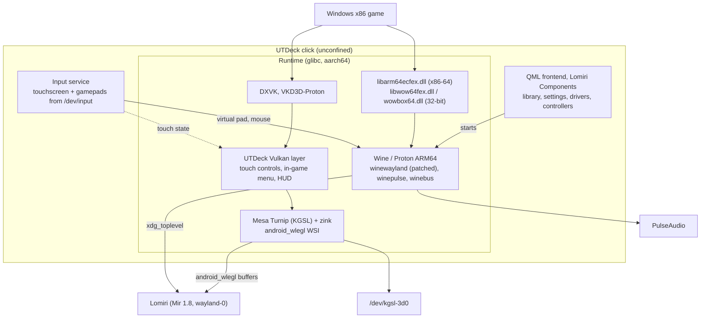

# UTDeck: feasibility, prior art and roadmap

Written 2026-11-17; updated 2026-11-21 after stage 3 (see "Where UTDeck stands" and the status
under each stage; the original plan text is kept as written). Sources: this repository (an unmodified copy of ARMDeck `main` at `d2585a6`),
the Dolphin port's notes (`../dolphin-ut/docs/ut-port/`), the stone-ut notes
(`../stone-ut/docs/`), the upstream projects listed in "Sources", and Wine's source tree
(`dlls/winewayland.drv`, master, read on 2026-11-17). Nothing was built, installed or changed on
any phone.

## The short answer

**Yes, it is a good idea, and nobody has built it yet.** It is not a matter of packaging
existing parts, though: three things found in this investigation must be solved first, and one of
them blocks upstream Wine on Lomiri outright.

- **Not reinventing the wheel.** No maintained project runs Windows games on Ubuntu Touch, or on
  any Halium system (Ubuntu Touch, Droidian, FuriOS, Sailfish), with Wine + DXVK + Turnip and a
  handheld UI. The only Ubuntu Touch attempt is **Winebox** (fredldotme/Box64AndWine): version 0.3
  from February 2023, with Box64 emulating all of Wine, GL4ES for graphics, no Vulkan, no DXVK, and
  a kernel `binfmt_misc` requirement that many ports do not meet. Its OpenStore reviews up to
  June 2024 say it does not work. UTDeck would be its successor, not a duplicate.
- **The hard parts already have proofs**, most of them our own:
  - Mesa Turnip (Android build) runs under libhybris with no root, through the stand-in
    `libvndksupport.so` from the Dolphin port (stage 4). Wind Waker and Need for Speed ran at
    100 % on it.
  - A native (glibc) Turnip can present on Halium compositors through libhybris' `android_wlegl`
    protocol: a Droidian Mesa build (panxiao81/debian-mesa, October 2026) did it on an Adreno 650,
    at 22.6 % CPU instead of 79.1 % for the software fallback. Lomiri offers `android_wlegl` v2
    (Dolphin stage 0).
  - Wine for ARM64 with FEX as an in-process x86 emulator (ARM64EC, explained below) is packaged
    for Ubuntu 24.04 by Hangover and by FEX's own PPA.
  - The Lomiri side (fullscreen, lifecycle, CPU boost, gamepads in an unconfined click, content-hub,
    the QML frontend) was solved once already for Dolphin.
- **What is not solved:**
  1. **Wine's Wayland driver refuses to start on Lomiri.** `winewayland.drv` treats `wp_viewporter`
     as required (`wayland.c`: "Wayland compositor doesn't support wp_viewporter", then
     `return FALSE`), and Lomiri's Mir 1.8 does not offer it (Dolphin `stage0-probe.md`). The X11
     route is no way out either: Xwayland on Ubuntu Touch only has llvmpipe (software rendering).
     No ready patch exists, but the pieces do (see "What has to be solved", 1): Wine made the
     protocol mandatory only in 9.17, so the old fallback is a starting point, and Proton's own
     scaling already covers games. UBports' coming Mir 2 has `wp_viewporter`, which will make the
     patch unnecessary later. Stage 2 below.
  2. **Wine's Wayland driver has no touch input at all** (no `wl_touch` anywhere in
     `winewayland.drv`). Touch controls, and touch as a mouse, have to come from UTDeck itself.
     Stage 5.
  3. **The vendor Vulkan drivers are too old for DXVK 2.x**, which needs Vulkan 1.3 (stone's blob
     is 1.1.128). So Turnip is not an extra here, it is the base of the product. Supported devices
     are therefore Adreno phones that Turnip supports, at first.
- **Set expectations honestly.** Removing proot and Android's framework saves memory, background
  CPU and system-call overhead. It does not make the GPU faster. A GPU-bound game on the same
  phone and the same Turnip should run at about the same frame rate as in DroidDeck; the gains
  show in CPU-bound games, loading, stutter and RAM headroom. Also, proot-free Wine already exists
  on Android (Winlator's Bionic forks, GameNative's Bionic launcher), so "no proot" alone is not
  the pitch. The pitch is: **a real glibc Linux on a phone that is still a phone**, with stock
  upstream Wine, FEX, Box64 and Mesa, and no Android in the way.

## Where UTDeck stands (2026-11-21)

Stages 0-3 are done (stage 3 wrapped up with items open, see its status below). On stone, a Windows
game from the maintainer's Steam library is started from Lomiri's app drawer, runs through Wine,
FEX or Box64, DXVK or VKD3D-Proton and our own Turnip, draws on Lomiri with the GPU, plays sound,
takes a Bluetooth gamepad and touch, pauses while the phone is locked or another app is in front,
and quits cleanly. Six of seven games tried run.

What turned out differently from the plan above:

| Plan (2026-11-17) | What happened |
| --- | --- |
| Route B (native Turnip) preferred, route A as fallback | **Route B** (stage 1): our Mesa with the Droidian `android_wlegl` presentation and our own patches (games below the compositor's GPU priority, one submission per command buffer, opaque pictures, a Direct3D 12 option built in). Route A hung at swapchain re-creation |
| A patch to make `wp_viewporter` optional; subsurfaces risky | Both worked (stage 2), plus touch as a mouse (the first finger). Lomiri logs Wine's subsurface requests as not implemented and crashed once (3.3): watched |
| Proton for esync | **Proton 11 has no esync** (only fsync and NTSYNC, which kernel 5.4 lacks). A wait through `wineserver` costs 17-24 µs, a few percent of a frame: no port. **Two Wine bases kept** as two Steam compatibility tools: Hangover's 11.16 (default) and Proton 11's (per game, downloaded on request) |
| Steam in stage 7 | **Steam moved into stage 3**: Valve's ARM64 client runs hidden as a service on an invisible X screen; UTDeck's runtime is its compatibility tool; one app drawer entry per installed game (3.8). Steam's own interface is too slow to use (software drawing) |
| Touch and controllers through `/dev/uinput` | `/dev/uinput` belongs to an Android system user (stage 0): no virtual devices, so Steam Input's virtual controller cannot exist; the real controller is passed to games |
| Lifecycle: survive Lomiri's SIGSTOP | Games started by hidden Steam are not Lomiri apps and were never paused: our own pause helper, with a Wine patch reporting the window's focus (3.6) |
| CPU boost as in Dolphin | Done and on by default (3.5): ATRI +7 %, Goat Simulator 2.4x; heat stayed low (skin 42 °C at most), the vendor's thermal service in charge |
| Linux builds of games (not planned) | A Linux x86 build has no GPU route here (GLX means Xwayland, software only): **UTDeck runs the Windows build** of games that have both (3.7) |
| Vulkan games (not planned) | Limited by the GPU, not the runtime: games made for the Steam Deck need features Adreno 6xx has only from its fourth generation (3.9). Direct3D 12 through VKD3D-Proton runs, and was a third faster than Direct3D 11 in one Unity game |
| Memory | Tight with heavy games: hidden Steam 1.1-1.3 GB, a game 1.5-1.7 GB, 0.6-0.9 GB left on the 8 GB phone |

**Recommended next steps:**
1. **Stage 4, the frontend, next.** Most of what stage 3 left open needs UTDeck to be a real app:
   games coming up portrait when started sideways (K1), Steam's dialogs and publishers' agreements
   waiting on an invisible screen, no feedback during a first start that takes minutes, the Windows
   build forced for games with a Linux build. The first question to answer in it: how a game
   started by hidden Steam gets the library app's identity in Lomiri (orientation, fullscreen), since
   Lomiri did not tie Wine's windows to an app in 3.6.
2. **The next game round inside stage 4**, not before it: adding three or more games through the
   new library brings the table to ten (stage 3's exit) and is stage 4's own test. Stage 3's
   leftovers for a game round (32-bit emulator choice, shader stutter, the open crashes) go with it.
3. Stage 5 (input) after 4; then packaging (6). Stage 8's stronger device brings back 3.9 (Vulkan
   games) and the GPU-bound games.

## Terms used in this document

- *Halium* = the layer that lets a Linux distribution run on an Android phone's own kernel and
  drivers. The Android vendor services run in a small container next to Linux.
- *libhybris* = the library that lets normal Linux programs (glibc) load Android's drivers (bionic,
  Android's C library). This is how Ubuntu Touch reaches the GPU on Halium phones.
- *KGSL* = Qualcomm's own GPU kernel driver on Android kernels. Mainline Linux uses `msm` instead.
- *Turnip* = Mesa's open-source Vulkan driver for Adreno GPUs. It can run on KGSL.
- *zink* = Mesa's OpenGL driver that runs on top of Vulkan, which gives desktop OpenGL on Turnip.
- *WSI* = window system integration: the part of a Vulkan driver that hands finished frames to the
  compositor (here: Lomiri).
- *android_wlegl* = libhybris' Wayland protocol for sharing Android graphics buffers between an app
  and a Halium compositor. *linux-dmabuf* is the standard protocol for the same thing, and Lomiri
  does not offer it.
- *wp_viewporter* = a standard Wayland protocol that lets the compositor scale a window's picture.
- *FEX* and *Box64* = x86 emulators for ARM: they translate x86 machine code to ARM64 while the
  program runs.
- *ARM64EC* = a Windows-on-ARM feature that Wine implements: Wine itself runs natively as ARM64,
  and only the game's x86 code goes through an emulator DLL (FEX's `libarm64ecfex.dll`). Winebox
  instead ran all of Wine under Box64.
- *WoW64* = Windows' way of running 32-bit programs; Wine's new WoW64 mode needs no 32-bit Linux
  libraries. 32-bit x86 games use FEX's `libwow64fex.dll` or Box64's `wowbox64.dll`.
- *DXVK* = Direct3D 8/9/10/11 to Vulkan. *VKD3D-Proton* = Direct3D 12 to Vulkan.
- *proot* = a tool that fakes a Linux root filesystem for an unprivileged app by intercepting every
  system call with `ptrace`. That interception is its cost.
- *Click* = Ubuntu Touch's app package format. *Unconfined* = a click without the AppArmor sandbox
  (OpenStore allows it after a manual review).
- *NTSYNC*, *fsync*, *esync* = three ways to do Windows thread synchronization fast on Linux. NTSYNC
  needs kernel 6.14, fsync needs `futex_waitv` from kernel 5.16, esync only needs `eventfd`.

## The three stacks side by side

| | DroidDeck | **UTDeck (proposed)** | ARMDeck |
| --- | --- | --- | --- |
| Base OS | Android 9+ (stock) | Ubuntu Touch 24.04 on Halium | postmarketOS, mainline kernel |
| Phone still works as a phone | Yes | **Yes** (calls, SMS, data, as the port supports) | No |
| Devices | Adreno 730+ or 8xx; 6xx, Mali, Xclipse, PowerVR experimental | Any Halium Ubuntu Touch phone with a Turnip-supported Adreno (first) | Only phones with mainline support |
| Linux userland | glibc rootfs under **proot** (ptrace) | **Native**: Ubuntu Touch is glibc already | Fedora in distrobox on musl host |
| Wine | Proton ARM64 | Wine ARM64 / Proton ARM64 built for Ubuntu 24.04 | Proton ARM64 |
| x86 code | FEX | FEX (ARM64EC, x86-64), FEX or Box64 (WoW64, 32-bit) | FEX |
| GPU driver | Turnip (glibc) | Turnip: native glibc build (route B) or Android build through libhybris (route A) | Turnip on `msm` (mainline) |
| Compositor | gamescope + KWin, "Desktop compositing is software rendered" (their README) | Lomiri (nested Mir 1.8 on `lomiri-system-compositor`, hardware composer) | gamescope on DRM |
| UI | Android launcher + Steam Big Picture | QML with Lomiri Components, touch and controller first | Steam Game Mode |
| Package | APK + ~3 GB runtime download | Click (unconfined) + runtime | Full system image |

What UTDeck removes compared with DroidDeck: proot, the Android framework and its background
services, Android's child process restrictions ("Disable child process restrictions" in Developer
options), and the software-composited desktop. What it keeps: the same Wine, the same FEX, the same
Turnip. What it adds: libhybris in the graphics path (route A only), and Lomiri's two compositors.

A note on DroidDeck's layers: its README describes proot ("Firefox sandboxing is reduced under
proot") and a KWin desktop in which compositing is done in software. I found no virtual machine in
it; if you saw one in its code, it should be added to this table.

## Prior art

| Project | What it is | Platform | State | Overlap with UTDeck |
| --- | --- | --- | --- | --- |
| [Winebox (Box64AndWine)](https://github.com/fredldotme/Box64AndWine) | Prebuilt Wine + Box86/Box64 + GL4ES as a click | Ubuntu Touch | v0.3, 2023-02-26, 61 commits, 14 stars. Reviews to 2024-06: "Currently not working", "no kernel support" (binfmt) | Same idea, older generation: all of Wine emulated, OpenGL through GL4ES, X11 through Xwayland, no Vulkan or DXVK, no game UI. **The only direct predecessor.** Its author, Alfred Neumayer (fredldotme), is a UBports core developer: worth contacting |
| [DroidDeck](https://github.com/Droid-Deck/DroidDeck) | SteamOS experience on Android: Steam, stores, desktop, VR | Android | Active, 0.7.1, GPL-3.0 | The UX model and a source of fixes (Wine on ARM64, FEX, Turnip settings). Its stack runs under proot |
| [Droid-Deck/Drivers](https://github.com/Droid-Deck/Drivers) | Weekly Turnip builds from Mesa main, **Android and Linux glibc (KGSL + MSM, Wayland/X11 WSI)** | Android, Linux | Active, GPL-3.0 bundle | A ready Linux glibc KGSL Turnip, built against Ubuntu 24.04 arm64. It has its own `linux_kgsl_wsi.py` patch: check what it does on Lomiri |
| [panxiao81/debian-mesa](https://github.com/panxiao81/debian-mesa/releases/tag/26.2.5-1-git20261019102112.adb4b85.droidian) | Debian Mesa with "vulkan/wsi/wayland: present through android_wlegl gralloc buffers" | Droidian | 2026-10-19 | **The missing piece for route B**: native Turnip presenting on a Halium compositor without linux-dmabuf. Tested on phoc, not Lomiri |
| [varmd/wine-wayland](https://github.com/varmd/wine-wayland) | An independent, Vulkan-only Wine Wayland driver (Wine 11.8) that needs no `wp_viewporter` | Arch Linux x86-64 | Last push 2026-05-12, 858 stars | Runs with only the protocols Lomiri has. No OpenGL, no GDI apps, no ARM64 build. UTDeck's fallback display driver |
| Winlator and its forks (Bionic, Ludashi, ...) | Wine + Box64 (and FEX) for Android | Android | Active, many forks | Bionic forks already skip proot. Source of game presets and known-good settings |
| GameNative, GameHub, WinHub, SkyNetEmu, OpenNative | Store front ends + Wine runtimes | Android | Active | GameNative has a Bionic (no proot) launcher. Store integration ideas (Steam, GOG, Epic) |
| [Hangover](https://github.com/AndreRH/hangover) | Wine for ARM64 Linux with FEX/Box64 emulator DLLs | Debian, Ubuntu 20.04-25.10, Termux | 11.0; the author plans to spend less time on it | **A building block**: Ubuntu 24.04 packages for first tests. Notes: DXVK "requires a Vulkan 1.3 driver", Wayland not used by default |
| FEX `fex-emu-wine` (Ubuntu PPA) | FEX's ARM64EC and WoW64 DLLs for Wine | Ubuntu | Active | A building block |
| Waydroid + Winlator on Ubuntu Touch | Android in a container on Ubuntu Touch, then Winlator inside it | Ubuntu Touch | Possible today | The opposite of the goal: more layers, not fewer |
| ARMDeck, Armada, pocknix, ROCKNIX, Nova-Deck | Mainline Linux gaming images | Mainline phones and handhelds | Active | Knowledge only (DXVK pins, FEX settings, game fixes); different base |
| dolphin-ut (ours) | Dolphin with a QML Lomiri frontend, Turnip under libhybris | Ubuntu Touch | Done, before OpenStore release | **The template for UTDeck**: everything Lomiri-specific |

No project named "UTDeck" turned up in web or OpenStore searches.

A Reddit thread from March 2025 in r/UbuntuTouch ("Gaming on UT through Winebox, is it possible")
shows the demand; it had no working answer.

## What our own work already proved

| Fact | Where | What UTDeck gets from it |
| --- | --- | --- |
| A Halium port with Ubuntu Touch 24.04-2.x takes days, not months, and ends fully working | stone-ut | The device base. UTDeck reaches more phones the same way |
| Turnip's Android build runs under libhybris with no root and no system change, chosen per app | dolphin-ut `stage4-adreno.md`, `ut/vkdriver/` | Route A works today |
| libhybris does not hook `pthread_barrier_*`; Turnip calls them in every `vkDestroyDevice` | same | The fix (a hook callback) carries over. Expect more of these gaps in Wine |
| Lomiri reports a 1x1 `currentExtent` for Wayland Vulkan surfaces, and swapchain re-creation hangs inside libhybris unless the surface is rebuilt | dolphin-ut stage 0, stage 2 | Wine's `winevulkan` will hit both on route A. Route B avoids them |
| Lomiri offers `xdg_wm_base` v1, `wl_subcompositor`, `android_wlegl` v2, `wl_seat` with touch; it does **not** offer `wp_viewporter`, `zwp_linux_dmabuf_v1`, pointer constraints, relative pointer, `xdg_activation_v1`, `wp_presentation` | dolphin-ut `stage0-probe.md` | Defines what Wine has to live without (below) |
| Xwayland on Ubuntu Touch gets only llvmpipe; there is no X11 GPU path in libhybris | dolphin-ut roadmap, stone-ut item 10 | Wine's X11 driver gives no GPU, except through a native Turnip with CPU copies |
| Fullscreen under Lomiri needs `set_fullscreen` after mapping, with no other window of the app showing; Lomiri keeps one saved window state per app | dolphin-ut 3.2, stage 5 | Wine games open launchers and dialogs: the same rules apply |
| Lomiri freezes background apps (SIGSTOP) | dolphin-ut 3.2 | Wine and the game must survive it, or the click gets a lifecycle exemption |
| CPU boost through `uclamp_min` on the app's own threads, without root, doubled Dolphin's speed | dolphin-ut 3.0, 3.6 | The same for game threads. It only asks the vendor's own frequency table for its top clocks: no limit is changed |
| Gamepads need an unconfined click; OpenStore reviews it by hand | dolphin-ut stage 5 | UTDeck will need it too (Wine also starts many processes and maps executable memory) |
| `memfd_create` instead of `/dev/shm` names, absolute Wayland and PulseAudio socket paths, `PULSE_PROP=media.role=multimedia` for the volume keys | dolphin-ut stage 2, 5 | Wine's `shm` use and `winepulse` will need the same launcher settings |
| The Dolphin port matched the Android app at the same emulated CPU clock | dolphin-ut `stage3-roadmap.md` | Encouraging, but the notes also say there is **no same-device baseline**. UTDeck should record one from day one (stage 0) |

## What has to be solved

### 1. Wine on Lomiri's Wayland (the blocker)

Wine has two display drivers:

- `winex11.drv` through Xwayland: no GPU on Ubuntu Touch. A native Turnip could still present to X11
  by copying frames through the CPU (Mesa's software WSI path), the way the Droidian patch measured
  at 79.1 % CPU. A fallback, not a product.
- `winewayland.drv`: native Wayland, Vulkan support since 2024. **It requires `wl_compositor`,
  `xdg_wm_base`, `wl_shm`, `wl_subcompositor` and `wp_viewporter`, and stops if one is missing.**
  Lomiri has all except `wp_viewporter`. Wine uses the viewport to scale a window's picture (a game
  running at 1280x720 on a 2400x1080 panel) and for the cursor.

#### Community solutions (investigated 2026-11-17)

**No ready patch makes today's `winewayland` run without `wp_viewporter`.** I searched Wine's
GitLab (code and history), Proton 10 and 11, the Proton-GE and CachyOS notes, gamescope and the
web. What exists, and how useful each piece is:

| Candidate | What it is | Use for UTDeck |
| --- | --- | --- |
| **Wine before 9.17** | `wp_viewporter` was optional until commit `0307268e` "winewayland: Require the wp_viewporter protocol" (Rémi Bernon, merged 2024-08-30 in MR !6386 "Reduce window surface buffer queue recreations"; first release: Wine 9.17). The requirement came with a refactor: since `20434f40`, Wine draws a window into a buffer that may be larger than the window and crops it with the viewport's source rectangle, so it does not rebuild buffers at every resize | **The starting point of our patch.** The reverse of `0307268e` (about 30 lines, mostly `if (wp_viewport)` checks) plus Wine 9.16's behavior for buffers (sized exactly to the window) is the fallback. No old version can be used as is: Hangover 9.15, the last release before 9.17, ships only `winex11` and a QEMU-based x86-64 emulator, with no `winewayland.drv` and no FEX ARM64EC (checked in its Ubuntu 24.04 package) |
| **Proton 10 and 11** | The same check (`proton_10.0` `wayland.c:272`, `proton_11.0` `wayland.c:309`) | No help with the check itself. But Proton 11's `win32u` keeps the **fullscreen hack**: when a game runs at a lower, emulated resolution, Proton renders it into its own images and scales it up in Vulkan (FSR or integer scaling, `WINE_FULLSCREEN_INTEGER_SCALING`) before presenting. So on a Proton base, scaling games does not need the compositor's viewport |
| **varmd/wine-wayland** | An independent Wine Wayland driver, Vulkan only, separate from Wine's own. On Wine 11.8, last push 2026-05-12, 858 stars. It binds `wl_compositor`, `wl_subcompositor`, `xdg_wm_base`, `wl_seat`, `wl_shm` and `wl_output`, and optionally pointer constraints and relative pointer: **no viewporter**. It has its own FSR upscaling (`WINE_VK_USE_FSR`) and an always-fullscreen switch | Everything it needs is on Lomiri, so it is the "similar enough" option. Its limits: no OpenGL; no GDI apps ("popups and simple launchers should work", in its words); x86-64 Arch packages only, so the aarch64 and ARM64EC build would be ours; no touch; no licence file in the repository (the code comes from Wine, which is LGPL, but ask before reusing it); one maintainer. **A fallback and a reference, not the base** |
| **`wp_viewporter` in Mir** | Upstream Mir has it since **2.18** (commit `40b2ecc`, 2024-06-26), created for every client with no shell setting needed. UBports packages Mir **2.28** for Ubuntu 26.04 (`packaging/mir2`) and is porting its Android/HWC2 platform to Mir 2.25 (`hybris-support/mir2-android-platform`, MR !1 open, updated 2026-11-13). The current Android platform builds only against Mir 1. UBports said the Mir 2 shell work is "too substantial for backporting" to 24.04 (Q&A 201, 2026-10-17) | **The real fix, and it is coming**: once Lomiri runs on Mir 2 on Halium phones, upstream Wine starts with no patch. That likely means an Ubuntu Touch on the 26.04 base; no date is given. A backport of Mir's viewporter into UBports' Mir 1.8 fork is possible, but it is UBports' code and Mir 2 makes it moot |
| gamescope | It has no `wp_viewporter` either (not in its protocol list); Proton games in gamescope normally go through Xwayland | No patch found from that side |
| A Wayland proxy that offers a dummy viewporter | Rejected: since 9.17 Wine relies on the viewport to crop its buffers, so ignoring the requests would show wrong pictures | None |

**Plan:**

1. **Our own patch, on Proton 11's `winewayland`** (and kept applicable to upstream): make
   `wp_viewporter` optional again. When it is missing: the null checks from the reverse of
   `0307268e`; window buffers sized exactly to the window, as in Wine 9.16; no cursor scaling;
   and games scaled by Proton's fullscreen hack. Expected to stay small (`wayland.c`,
   `wayland_surface.c`, `wayland_pointer.c`, maybe `window_surface.c`). It is a temporary patch,
   dropped when Lomiri on Mir 2 reaches Halium phones. Wine made the requirement on purpose, so
   upstream will probably not take it back: we carry it, and offer it only if asked.
2. **varmd's driver as the fallback** if the patch runs into trouble on Mir 1.8, and as a
   reference for Vulkan-side FSR.
3. **Tell UBports about this use case** in their Mir 2 work: Wine games need `wp_viewporter`, which
   they will get for free with Mir 2. Ask about the timeline.

#### A second problem found on the way: subsurfaces

Both Wine's driver and varmd's put the game's picture on a **subsurface** (a child surface of the
window, `wl_subsurface`, set to desync). The Dolphin port had trouble with subsurfaces on Lomiri:
after one was destroyed, Lomiri kept its last frame on screen, and fullscreen crashed once
(Dolphin stage 2, S2-M4). So the Dolphin port does not use them. UBports' Mir 2 packaging has a
branch from 2026-11-15, "release buffers replaced in a sync subsurface cache", so subsurface handling
is still being fixed even in Mir 2. **Stage 2 tests this first.** If it fails, a second small patch:
when a fullscreen game's picture covers the whole window, Wine draws it on the window's own surface
instead of a subsurface.

Also missing on Lomiri, with what it costs: pointer constraints and relative pointer (mouse-look
games with a real mouse; fine with a gamepad), `xdg_activation_v1` (bringing a window forward),
`wp_presentation` (frame timing feedback). `xdg_wm_base` is v1; Wine binds up to v2, so v1 is fine.

### 2. A Vulkan 1.3 driver: Turnip, by one of two routes

| | Route A: Android Turnip through libhybris | Route B: native glibc Turnip |
| --- | --- | --- |
| How | Dolphin's stand-in `libvndksupport.so` makes Android's Vulkan loader load Turnip from the app's folder | Mesa built for glibc with `freedreno-kmds=kgsl`, talking to `/dev/kgsl-3d0` directly, loaded by the normal Khronos loader |
| Presentation | libhybris' `vulkanplatform_wayland` (proven on Lomiri) | Needs the `android_wlegl` WSI patch (proven on phoc, not on Lomiri) |
| Status | **Works today** in dolphin-ut | Unproven on Ubuntu Touch |
| Inside Wine's process | bionic, libhybris' linker and its TLS padding (`GLIBC_TUNABLES`, `libtls-padding.so`) all live in Wine's Unix side, next to Wine's own signal handling and thread setup. Unproven, and Wine is far more sensitive to this than Dolphin | Only glibc code. Much cleaner |
| Known quirks | 1x1 `currentExtent`, swapchain re-creation hang, missing pthread hooks | A CPU wait before each present (KGSL attaches no fences to dma-bufs) |
| OpenGL | No | **zink on top gives desktop OpenGL 4.6**, which Wine's own Direct3D (WineD3D) and OpenGL games need |
| X11 fallback | No (libhybris has no X11 Vulkan platform) | Yes, with CPU copies |

**Recommendation: build on route B, keep route A as the fallback.** Route A is the quick start
(it works now, so stage 2 can begin on it), route B is the product. Stage 1 decides with numbers.

The vendor driver stays the default for anything that is not a game (Lomiri, other apps). UTDeck
never replaces system files: the driver is per app, as in dolphin-ut.

### 3. Touch, in a driver that has none

`winewayland.drv` does not read touch events. On Lomiri, a touch on the game's window reaches Wine
as nothing. So:

- **Touch controls** (an on-screen gamepad, as in DroidDeck and Winlator) and **touch as a mouse**
  for launchers and menus have to be produced by UTDeck.
- Proposed design, to be tested in stage 5:
  - an **input service** in the click that reads the touchscreen and gamepads from `/dev/input`
    (phablet is in `android_input`, and the click is unconfined), and turns touches into a virtual
    controller and mouse events;
  - those reach Wine through `/dev/uinput` (a virtual input device) if Ubuntu Touch lets phablet
    open it, otherwise through a small Wine-side helper or a `winewayland` patch that turns
    `wl_touch` into mouse events;
  - the controls and the in-game menu are **drawn into the game's own picture by a Vulkan layer**
    (a small library Vulkan loads between the game and the driver, as MangoHud does). This is the
    same "draw inside the game picture, no second surface" decision as Dolphin's window
    architecture A, and for the same reason: Lomiri shows one fullscreen surface per app well.

### 4. Old Halium kernels

stone runs kernel 5.4. Halium kernels range from about 4.14 to 5.15 (6.1 on the newest devices).

- **No NTSYNC** (6.14) and, on 5.4, **no fsync** (`futex_waitv`, 5.16). Upstream Wine then falls back
  to `wineserver` for synchronization, which costs most in CPU-bound games, more so on ARM where it
  means extra calls through the emulation. Proton keeps **esync**, which only needs `eventfd`. So
  the product runtime should be built from Proton's ARM64 sources, not plain upstream Wine.
- On our own ports (stone), NTSYNC is a small, self-contained driver that could be backported to the
  Halium kernel as a module. ARMDeck turned it on and measured it (it hung Subnautica, so it needs a
  per-game opt-out: `docs/compat-perf-audit.md`). Optional, and only for ports we build.
- `binfmt_misc` is **not needed**: Wine is native ARM64, and FEX and Box64 run as Wine DLLs. This
  removes the reason Winebox failed on most devices.
- Unprivileged user namespaces matter only for the Steam client (its container, pressure-vessel).
  Check per device.

### 5. Everything in user space

The Ubuntu Touch root filesystem is read-only and updated as an image; `apt install` does not last.
The runtime (Wine, FEX, Box64, DXVK, VKD3D-Proton, Mesa) lives in the click or is downloaded into
the app's data folder at first start, as DroidDeck does with its ~3 GB runtime. Prefixes, games
and shader caches live in `~/.local/share/<app id>` and `~/Documents/UTDeck` (MTP-visible), as
Dolphin's games do.

## Proposed architecture

The rest of Ubuntu Touch stays as it is: the phone keeps calls, data and notifications, and
UTDeck is one app in the drawer.

The Dolphin port fits next to it: UTDeck's library can list Dolphin's games and start the Dolphin
click, and later other emulators packaged the same way.

## Roadmap

Each stage has a goal, steps and an exit check, as in the Dolphin and stone-ut notes. Later stages
get their own documents in this folder. Development device: stone (Redmi Note 12 5G, Adreno
619v2, Ubuntu Touch 24.04-2.x, Halium 14, kernel 5.4), because the whole port is ours and its
kernel can be rebuilt. Second device: the Nothing Phone (1) (Adreno 642L, 24.04-1.x), see
"Decisions".

### Stage 0. Probe and baseline (no code)

Goal: know the ground before building anything.

1. Kernel features on stone, read from `/proc/config.gz` and by trying them: user namespaces,
   `futex_waitv`, `eventfd`, `userfaultfd` (DroidDeck's Wine write-watch support uses it),
   `memfd_create`, `/dev/uinput` and who may open it.
2. Lomiri's `android_wlegl` v2: does it answer `get_server_buffer_handle` (what the Droidian WSI
   patch uses)? A small Wayland client is enough.
3. Free memory and CPU at idle, with Lomiri, the Halium container and Waydroid stopped. The same
   figure for crDroid would be the Android baseline; it is no longer on stone, so take it from
   another phone with the same SoC, or note the gap.
4. Turnip support for Adreno 619 on this KGSL: already shown by dolphin-ut (Android build).
   Confirm the Linux build from Droid-Deck/Drivers loads and creates a device.
5. **The baseline that answers "is it better than DroidDeck?"**: pick two or three games (one
   GPU-bound, one CPU-bound, one 32-bit), and measure them on Android with DroidDeck or GameNative
   on a phone UTDeck will also run on, before that phone gets Ubuntu Touch. Frame rate, frame
   times, RAM in use, temperature and battery over 15 minutes.

Exit: a yes/no table, as in Dolphin's stage 0, and the baseline numbers.

#### Status (2026-11-18): done

Notes: [stage0-probe.md](stage0-probe.md). Native Turnip loads and creates a device on stone's
Halium kernel, Lomiri hands out the linear gralloc buffers the `android_wlegl` WSI patch needs, and
DXVK 2.7.1's requirements are all met, so stage 1 goes to route B. Found on the way: a 39-bit
address space (Wine 11.15 or later), no fsync, NTSYNC or `userfaultfd` (Proton's esync), and no
`/dev/uinput` for apps (touch must reach Wine directly). Step 5 used Geekbench 6.7.1 against
published Android results instead of a second phone: the CPU performs like Android (866 / 1973).
Also found: both Turnips (Mesa 27.0 Linux, Mesa 25.3 R11 Android) fail Geekbench's Vulkan compute
test on the A619 where the vendor driver passes, and Lomiri's shared-memory path shows a torn picture
when the row stride is padded. Both are stage 1 items.

### Stage 1. Vulkan 1.3 on Lomiri (no Wine yet)

Goal: a modern Vulkan driver drawing on Lomiri's screen, chosen per app.

1. Route B: build Mesa (Turnip + zink) for Ubuntu 24.04 arm64 in a cross container like
   dolphin-ut's `ut/docker/`, with the `android_wlegl` WSI patch. Compare with Droid-Deck/Drivers'
   Linux build and its `linux_kgsl_wsi.py`.
2. `vkcube` and `vulkaninfo` on Lomiri, fullscreen: frames reach the screen, at what CPU cost,
   with what present modes. Check DXVK 2.7's required features on the A619 (ARMDeck and DroidDeck
   both pin DXVK 2.7.x on Adreno 6xx; DXVK 3 needs a feature the A650 lacks).
3. zink on Turnip: an OpenGL 4.6 context on Lomiri (`glxgears` on Wayland or `eglgears_wayland`).
4. Route A: the same tests through dolphin-ut's shim, for comparison.

Exit: route A or B chosen, with numbers. If B fails on Lomiri, A is the base and zink is out.

#### Status (2026-11-18): done, route B chosen

Split into four substages: [stage1-roadmap.md](stage1-roadmap.md). Our own Turnip build (Mesa
26.2.5 with the Droidian `android_wlegl` patch, `tools/mesa-build/`) presents on Lomiri with no CPU
copies (1.1); our patches 0001 (games below the compositor's GPU priority) and 0002 (one KGSL
submission per command buffer) fix the frozen UI and the GPU timeout (1.2); zink gives OpenGL 4.6
and GLES 3.2 (1.3). Decision ([stage1.4-decision.md](stage1.4-decision.md)): **route B**; route A
hangs at swapchain re-creation and cannot carry 0001/0002. Games run without vsync waiting, with a
frame limiter, because Lomiri answers frame callbacks late.

### Stage 2. First light: one Windows game on screen

Goal: Wine for ARM64 with FEX draws a Direct3D game on Lomiri with the GPU.

1. Build Wine for aarch64 with ARM64EC in the cross container (Hangover 11's sources, or Proton 11's
   with FEX's DLLs from its Ubuntu PPA), unpacked into a folder on the phone (no apt install).
   Prebuilt Hangover packages are not enough: the ones before 9.17 have no Wayland driver, and the
   later ones need the patch in step 2.
2. Patch `winewayland.drv`: `wp_viewporter` optional (plan in "What has to be solved", 1). Keep the
   patch small and separate, so it can be dropped when Lomiri moves to Mir 2.
3. Test the subsurface path first: a Vulkan sample, fullscreen, closed and reopened several times,
   checking for stale frames and crashes. If it fails, the second patch (the game drawn on the
   window's own surface).
4. Apply the Lomiri lessons from Dolphin: socket paths, `memfd_create`, `PULSE_PROP`, fullscreen
   after mapping.
5. Test in this order: a D3D9 sample, a D3D11 sample (DXVK 2.7), then one real game the maintainer
   owns. Sound through `winepulse`, a Bluetooth gamepad through `winebus`.
6. Fallbacks if step 2 or 3 stalls: varmd's Vulkan-only driver built for aarch64, or `winex11`
   through Xwayland with route B's software presentation, to keep the rest of the work moving.

Exit: one D3D11 game playable on screen, with frame rate, CPU, GPU and RAM recorded against the
stage 0 baseline.

#### Status (2026-11-18): done

Split into four substages: [stage2-roadmap.md](stage2-roadmap.md). 2.1
([stage2.1-wine-console.md](stage2.1-wine-console.md)): Hangover 11.16 runs Windows console
programs on stone (ARM64 native, x86-64 through FEX at 79 % of native speed in one thread, 32-bit
x86 through Box64 or FEX), with no change to the system.
2.2 ([stage2.2-winewayland.md](stage2.2-winewayland.md)): Wine's Wayland driver runs on Lomiri
with our two patches (`wp_viewporter` optional; the first finger as the mouse, since Wine had no
touch input); Notepad and `winecfg` are drawn correctly and usable by touch.
2.3 ([stage2.3-vulkan-in-wine.md](stage2.3-vulkan-in-wine.md)): a Windows Vulkan program runs
through Wine on our Turnip with zero-copy buffers and no stale frames; with two more patches it
follows Lomiri's rotation and keeps the whole screen when started as a landscape Lomiri app.
2.4 ([stage2.4-direct3d.md](stage2.4-direct3d.md)): 3DMark 11 (Direct3D 11) installed and run
through Wine, FEX, DXVK and our Turnip, drawn correctly with sound and scaled to the screen: P566
(about an Intel HD 4000); a Bluetooth gamepad works as an XInput controller. Stage 2 exit met.

### Stage 3. A runtime we build and own

Goal: a reproducible runtime, tuned for Halium phones.

1. Build Wine from Proton 11's ARM64 sources (esync, game fixes, its `winewayland` patches) in the
   cross container, with FEX's DLLs, Box64's `wowbox64.dll`, DXVK 2.7.x and VKD3D-Proton.
2. Defaults learned in ARMDeck and DroidDeck: `DOTNET_EnableWriteXorExecute=0` (.NET games hang
   under FEX without it), FEX TSO per game, the DXVK pin for Adreno 6xx, `TU_DEBUG` options per GPU,
   NTSYNC off by default where it exists.
3. CPU boost (`uclamp_min`) for the game's threads, as in Dolphin. Watch temperatures over long runs:
   PC games load CPU and GPU together for longer than Dolphin did. The vendor's thermal service
   keeps control; UTDeck never raises a limit.
4. Lifecycle: what Wine and the game do under Lomiri's SIGSTOP; pause on app switch and screen lock.
5. A compatibility table: the maintainer's games, against the baseline.

Exit: the runtime builds from a script, and the table has ten or more games.

#### Status (2026-11-21): wrapped up, with items open

Notes and the full list of open items: [stage3-roadmap.md](stage3-roadmap.md), "Stage 3 wrapped up".
The runtime builds from one script (both Wine bases, pinned, byte-identical): met. The table has
seven games, six of which run (Direct3D 9, 11 and 12; 32- and 64-bit; Box64 and FEX; five engines):
three short of ten, to be added in stage 4's game round. Substages: 3.1 runtime build, 3.S Steam
hidden as a service, 3.2b the table, 3.3 two Wine bases, 3.4 defaults in one file
(`defaults.env`; items 8-11 open), 3.5 CPU boost on by default, 3.6 pause on lock and on focus loss,
3.7 Linux builds (rule: the Windows build), 3.8 games in Lomiri's app drawer, 3.9 Vulkan games
(closed until a stronger device). Two runtime releases are on GitHub (Proton's base, downloaded on
request). Open items go to a game round (crashes in Ys IX, Goat Simulator on our base, Aperture Desk
Job's lock-up, 32-bit emulator choice, shader stutter, DirectShow movies), to stage 4 (orientation,
hidden Steam's dialogs, a starting screen, Linux-build forcing), stage 5 (controller hot-plug, the
on-screen keyboard) and stage 8 (Vulkan games, the Nothing Phone).

#### Status (2026-11-18): 3.1 done

Split into six substages: [stage3-roadmap.md](stage3-roadmap.md). Checked first: Proton 11's Wine
is Wine 11.0 and has no esync any more (only fsync, which needs Linux 5.16), so on this kernel it
waits through `wineserver` like upstream Wine; the base is decided by measurement in 3.3. 3.1
([stage3.1-runtime-build.md](stage3.1-runtime-build.md)): one script builds the whole runtime from
pinned sources, byte-identical between builds, half Hangover's size, equal in every test, with
VKD3D-Proton added (Direct3D 12 runs on the A619); it is now the default on the phone, and 3DMark
11 and the gamepad work on it. 3.2 closed with no games in the table (the copies at hand carried DRM
bypasses); Steam moves forward into stage 3 ([plan-change-steam-early.md](plan-change-steam-early.md)).
3.S (Steam through UTDeck's runtime, hidden) and 3.2b (five games from the maintainer's Steam
library: Direct3D 9, 11 and 12, 32- and 64-bit) are done; the plan for the rest of stage 3 (3.3 the
Wine base, 3.4 defaults, 3.5 boost, heat and memory, 3.6 lifecycle, 3.7 Linux games) and the items
moved to stages 4, 5 and 8 are in [stage3-roadmap.md](stage3-roadmap.md).

### Stage 4. The frontend

Goal: someone picks up the phone and plays, without a keyboard.

Reuse dolphin-ut's frontend patterns (window handling, settings model, storage, content-hub,
per-game settings). Pages:

1. Library: cover grid, "Add a game" (an installer, an `.exe`, or a folder copied over MTP into
   `~/Documents/UTDeck/Games`), details, per-game settings.
2. Per-game settings: driver (system, Turnip versions), DXVK version, resolution and scaling, FEX
   options, esync/NTSYNC, CPU boost, environment variables for experts.
3. Prefix (Wine bottle) management: create, reset, back up, winetricks-style components.
4. Driver manager: Turnip packages, as Dolphin's GPU Driver page, in both the Android (route A) and
   Linux (route B) formats.
5. Controllers: detection, mapping, profiles, as Dolphin's stage 3.5.

Exit: from a fresh install, add a game, start it, play with a gamepad, quit back to the library.

Added after stage 3 (2026-11-21). The library starts from what exists: `steam-library.py` (installed
Steam games and their covers), `steam-service.sh play` (hidden Steam started, its sign-in awaited,
the game launched), per-game `utdeck-env` and `defaults.env`. What stage 3 left for it:
1. **The game's window as part of the library app**: started sideways, a game comes up portrait
   (K1); landscape-only games are reshaped to portrait; a maximized window keeps Lomiri's top bar.
   Stage 2.3 showed that a game started as a landscape Lomiri app keeps the whole screen, but a game
   started by hidden Steam is Steam's child, and Lomiri did not tie Wine's windows to an app (3.6).
   This is the first thing to find out.
2. **Hidden Steam's dialogs shown to the user**: publishers' agreements and Steam's notices before a
   launch wait on its invisible screen (3.2b, 3.9). UTDeck shows them; only the user accepts an
   agreement.
3. **A starting screen**: a first start can take minutes (Wine Mono, Steam's install scripts) with
   nothing on screen, and Lomiri does not show our notifications (3.8).
4. **Games with a Linux build**: UTDeck's tool forced right after the game is added, before the
   first download (3.7's rule, 3.9).
5. **Per-game settings** map to `utdeck-env`: the Wine base, launch options (`GAME_ARGS`), boost,
   pause, logs.
6. **Steam's own tasks** without its interface (K2): sign-in, install, uninstall, free space.
7. **The next game round** through the new library: three or more games bring stage 3's table to
   ten, with stage 3's leftovers for a game round (see its notes).

### Stage 5. Touch controls, in-game menu, overlay

Goal: games are playable with touch only, and the menu works during a game.

1. Input service and virtual controller (see "Touch, in a driver that has none").
2. The Vulkan layer: on-screen controls with edit mode, scale and opacity; the in-game menu
   (pause, settings, quit, screenshot); a performance HUD.
3. Touch as a mouse for launchers and menus: tap, drag, right click by long press.
4. Haptics through hfd-service, as Dolphin does.

Exit: a game that needs a mouse launcher and a gamepad in game is playable with touch only.

Added after stage 3 (2026-11-21): `/dev/uinput` is not open to apps (stage 0), so step 1's virtual
controller has to come from inside Wine (for example a source in its `winebus` driver) rather than
from the kernel. Steam Input's own virtual controller is made by the Steam client through
`uinput`, so it stays unavailable; games get the real controller (3.2b). Also here: a controller
connected while a game runs (K3), the on-screen keyboard (Lomiri offers Wine no text-input
protocol), and touch beyond our patch's "the first finger is the mouse".

### Stage 6. Packaging and release

1. Click, unconfined, with the justification for the OpenStore review (gamepads, Wine's process
   model).
2. Runtime delivery: inside the click, or downloaded at first start (decision below). Check
   OpenStore's size limit.
3. Licences and sources: links to the exact sources of Wine, Mesa, FEX, Box64, DXVK and UTDeck.
   No Qualcomm files are shipped or downloaded.
4. Both frameworks, as Dolphin did: 24.04-2.x, and 24.04-1.x with bundled Qt 6.

Exit: the click installs on a clean user account on two devices and games run with no manual
setup.

Added after stage 3 (2026-11-21): downloading a runtime at first use already works for the second
Wine base (`get-runtime.sh`: GitHub releases, SHA-256 checked, `runtimes.list`); the same path can
carry the default runtime and Mesa. Hidden Steam, its Xvfb and the per-game helpers run as systemd
user services today: how they fit a click is part of this stage.

### Stage 7. Stores and Steam

1. DRM-free first: GOG (offline installers, then a GOG login through an existing open client such
   as gogdl), itch.io.
2. Epic through legendary (Python, runs natively on ARM64).
3. Steam, a spike with two candidates:
   - Valve's Steam ARM64 Linux client, natively on Ubuntu Touch's glibc. Its UI goes through
     Xwayland, so it renders in software (DroidDeck's desktop does too); games then start through
     Proton with `PROTON_ENABLE_WAYLAND=1`. Its game container needs user namespaces (stage 0).
   - The Windows Steam client inside Wine: heavier (its browser runs under FEX).

   No DRM bypass or Steam emulator is shipped.

Exit: games from at least two stores start from UTDeck's library.

Plan change (2026-11-19): the part of step 3 that lets Steam games start through UTDeck's runtime
moves into stage 3 (stage 3.S), so the compatibility table can use the maintainer's Steam library:
[plan-change-steam-early.md](plan-change-steam-early.md). The rest of this stage stays here.

Status after stage 3 (2026-11-21): step 3 is done the first way (Valve's ARM64 client, hidden). Left
here: GOG, itch.io and Epic; Steam's overlay (K8) and pipeline cache.

### Stage 8. More devices

1. A device profile file: GPU family, Turnip support, the DXVK pin, known quirks, thermal notes.
2. The Halium porting guide from stone-ut, linked as "how to bring your phone".
3. Mali phones (most MediaTek Ubuntu Touch devices, for example Volla and FuriLabs): no Turnip and
   no open driver on Android kernels, so only the vendor's Vulkan through libhybris. DXVK 2.x needs
   that blob to be Vulkan 1.3. Check per device, later.

Added after stage 3 (2026-11-21):
- The device profile also records what the GPU generation can do: subgroup operations in drawing
  shaders (Adreno 6xx from its fourth generation: 660, 690, the A635 family including the 642L;
  all of 7xx), which games made for the Steam Deck require (3.9); descriptor sets for
  VKD3D-Proton (Mesa patch 0006 on 6xx).
- **A more powerful device running Ubuntu Touch** brings back 3.9 (Vulkan games measured against
  their Direct3D path) and the GPU-bound games (Ys IX, Stray). The maintainer judges the Nothing
  Phone (1) not capable enough for that; it stays the second device for the runtime check.

## Risks

| # | Risk | Likelihood | Impact | What we do |
| --- | --- | --- | --- | --- |
| 1 | `winewayland` needs more than the viewporter patch on Mir 1.8 (old protocol versions, configure quirks, popups) | Medium | High | Stage 2 starts with this; varmd's driver or `winex11` + software presentation as fallbacks; Mir 2 removes the need for the patch later |
| 1b | Lomiri mishandles Wine's game subsurface (stale frames, crashes, as Dolphin saw) | Medium | High | Tested first in stage 2; a patch to draw fullscreen games on the window's own surface |
| 2 | Route B's `android_wlegl` WSI does not work on Lomiri's implementation | Medium | Medium | Route A works today; zink is then lost |
| 3 | Wine and libhybris in one process (route A) clash: TLS, signals, thread hooks | Medium | High for route A | Prefer route B; if A is needed, test early with `winevulkan` |
| 4 | Touch input through `/dev/uinput` is not allowed for phablet | Medium | Medium | A Wine-side helper, or a `winewayland` touch patch |
| 5 | Adreno 6xx performance ceiling (stone has two big cores; DroidDeck lists 6xx as experimental) | High | Medium | Document per game; the Nothing Phone (1) as the stronger device; DXVK 2.7 pin |
| 6 | Old kernels: no NTSYNC or fsync, slower CPU-bound games | High | Medium | Proton's esync; NTSYNC backport on our own ports |
| 7 | The gain over DroidDeck is smaller than hoped in GPU-bound games | Medium | Medium | Same-device baseline in stage 0, honest numbers in the README |
| 8 | Memory: Halium's Android container plus Lomiri plus Wine on 6-8 GB phones | Low | Medium | Measure in stage 0; stop Waydroid during games |
| 9 | OpenStore refuses or delays an unconfined click, or its size | Low | Medium | Same review Dolphin goes through; runtime download if needed |
| 10 | Upstream churn: Wine, Proton ARM64, FEX, Mesa main move fast; Valve's ARM64 Proton is new | High | Low | Pin versions per release; `tools/check-sources.py` for the upstreams |
| 11 | Lomiri's window handling of Wine's extra windows (launchers, dialogs, splash screens) | Medium | Medium | Dolphin's fullscreen rules; a per-game "single window" option |
| 12 | Licence mix: reusing DroidDeck code (GPL-3.0) in an MIT repository | Certain if code is reused | Low | Decide the licence before the first copied line (below) |
| 13 | Heat in long sessions on a phone without a fan | Medium | Medium | Vendor thermal control stays in charge; HUD shows temperature; no limit is ever raised |

What stages 0-3 showed about these risks (2026-11-21):
- 1 and 1b: handled by our patches; Lomiri crashed once while logging Wine's subsurface requests
  as not implemented (3.3), and hung once during an automated run (3.4). Still watched.
- 2 and 3: gone with route B.
- 4: confirmed, `/dev/uinput` is not open to apps; Steam Input's virtual controller is lost too.
- 5: confirmed and sharper: GPU-bound games run at 8-23 fps, and games made for the Steam Deck can
  need GPU features first-generation Adreno 6xx lacks (3.9).
- 6: Proton has no esync either; the measured cost of `wineserver` waits is a few percent.
- 8: higher than "Low": with hidden Steam and a heavy game, 0.6-0.9 GB stays free of 8 GB.
- 13: low on stone so far (skin 42 °C at most over 30 minutes, plugged in); battery drain not
  measured.
- New: games that wait on hidden Steam's invisible dialogs (agreements, notices), until stage 4.

## What carries over from ARMDeck

This repository is ARMDeck. Most of it does not apply to a Halium product:

- **Does not apply:** `pmaports/` (mainline kernel and device packages), the thermal guard,
  charging and audio limiters (on Halium the vendor's own services do this), deep sleep work,
  `reference/dts/`, the Steam Game Mode session and Decky.
- **Applies as knowledge:** `docs/compat-perf-audit.md` (Proton ARM64, DXVK pins, NTSYNC per game,
  FEX TSO), `docs/patch-scan.md` (DroidDeck's Wine and FEX fixes), `docs/widescreen.md`.
- **Applies as is:** `tools/check-sources.py` and `docs/sources.md`, `CONTRIBUTING.md` and the Code
  of Conduct (adjusted), the verification-log habit.

## Decisions for the maintainer

1. **Repository.** Keep this fork and trim the ARMDeck-only parts once UTDeck has code (history
   and shared tools stay), or start a fresh repository and keep ARMDeck separate. Recommended: keep
   the fork for now, move ARMDeck-only folders out in one commit when stage 1 starts.
2. **Licence.** ARMDeck is MIT. DroidDeck and Droid-Deck/Drivers are GPL-3.0, and Dolphin is
   GPL-2.0-or-later. If UTDeck will reuse DroidDeck code, GPL-3.0 is the simple choice.
3. **Devices.** stone as the development device (recommended), the Nothing Phone (1) as the second.
4. **Runtime base.** Hangover or FEX packages for first light (stage 2), Proton ARM64 sources for
   the product (stage 3). Recommended as written.
5. **Runtime delivery.** In the click (simple, large) or downloaded at first start (small click,
   needs a download server or GitHub releases).
6. **Steam scope.** Whether Steam is a goal for the first release or comes after DRM-free stores.
7. **Upstream contacts.** Whether to contact fredldotme (Winebox), UBports (Wine games need
   `wp_viewporter`, which Mir 2 brings; the timeline of the Mir 2 Android platform), varmd (licence
   of wine-wayland, in case we reuse its code) and the Droidian WSI patch's author before stage 1.

Where these stand after stage 3 (2026-11-21): 3 (devices): stone is the development device, as
recommended. 4 (runtime base): both, as two Steam compatibility tools (3.3). 5 (runtime delivery):
downloading from GitHub releases works for the second base; the choice for the click is stage 6's.
6 (Steam scope): Steam came first, in stage 3. 1, 2 and 7 are not recorded here as decided.

## Sources

Our own notes:
- dolphin-ut: `docs/ut-port/roadmap.md`, `stage0-probe.md`, `stage2-wayland.md`,
  `stage3-roadmap.md`, `stage3.2-emulation.md`, `stage4-adreno.md`, `stage5-packaging.md`.
- stone-ut: `docs/feasibility.md`, `docs/roadmap-hardware-2.md` (items 10, 11).
- ARMDeck (this repository): `docs/compat-perf-audit.md`, `docs/patch-scan.md`, `docs/sources.md`.

Upstream:
- DroidDeck README: https://github.com/Droid-Deck/DroidDeck
- Droid-Deck/Drivers: https://github.com/Droid-Deck/Drivers
- Winebox: https://github.com/fredldotme/Box64AndWine and
  https://open-store.io/app/box64andwine.fredldotme/
- Droidian Mesa with the `android_wlegl` WSI:
  https://github.com/panxiao81/debian-mesa/releases/tag/26.2.5-1-git20261019102112.adb4b85.droidian
- Hangover: https://github.com/AndreRH/hangover
- FEX: https://github.com/FEX-Emu/FEX and https://wiki.fex-emu.com/index.php/Development:ARM64EC
- Wine's Wayland driver: https://gitlab.winehq.org/wine/wine/-/tree/master/dlls/winewayland.drv
  (`wayland.c`, required globals); Vulkan support: https://gitlab.winehq.org/wine/wine/-/merge_requests/4340
- The commit that made `wp_viewporter` required:
  https://gitlab.winehq.org/wine/wine/-/commit/0307268e4dd7274e006db679d788624bab9646eb
  (MR https://gitlab.winehq.org/wine/wine/-/merge_requests/6386), and the source-rectangle commit
  https://gitlab.winehq.org/wine/wine/-/commit/20434f40
- Proton's Wine: https://github.com/ValveSoftware/wine (branches `proton_10.0`, `proton_11.0`:
  `dlls/winewayland.drv/wayland.c`, `dlls/win32u/vulkan.c` for the fullscreen hack)
- varmd/wine-wayland: https://github.com/varmd/wine-wayland
- Hangover 9.15 package (no Wayland driver, no ARM64EC):
  https://github.com/AndreRH/hangover/releases/tag/hangover-9.15
- Mir's viewporter: https://github.com/canonical/mir/blob/main/src/server/frontend_wayland/wp_viewporter.cpp
  (added in 40b2ecc, first in v2.18.0)
- UBports Mir 2 Android platform:
  https://gitlab.com/ubports/development/core/hybris-support/mir2-android-platform (MR !1);
  Mir 2 packaging: https://gitlab.com/ubports/development/core/packaging/mir2
- UBports Q&A 201 (Mir 2 status): https://ubports.com/blog/ubports-news-1/ubuntu-touch-q-a-201-4016
- Collabora, Wine on Wayland 2024 review:
  https://www.collabora.com/news-and-blog/news-and-events/wine-on-wayland-a-year-in-review-and-a-look-ahead.html
- GameNative launchers (Bionic path without proot): https://deepwiki.com/utkarshdalal/GameNative/6.3-program-launchers
- Winlator Bionic/glibc fork (archived 2025-06-30): https://github.com/Succubussix/winlator-bionic-glibc
- libhybris: https://github.com/libhybris/libhybris
- UBports Waydroid documentation: https://docs.ubports.com/en/latest/userguide/dailyuse/waydroid.html
